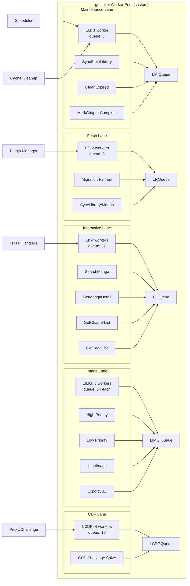

# Workers Audit Report

## Current Pool Implementation

### Lane Configuration
|Lane|Workers|Queue|Sub-queues|
|---|---|---|---|
|Interactive|4|32|none|
|Fetch|2|8|none|
|Image|8|64 each|high/low|
|Maintenance|1|8|none|
|CDP|4|16|none|

### Job Submission Points (5 direct + 5 via wrappers)

**Direct `pool.Enqueue`**
1. `internal/bridge/image.go:219` — `fetchImage` → image lane, no dedupe key
2. `internal/bridge/sync.go:172` — `SyncLibrary` → fetch lane
3. `internal/bridge/sync.go:189` — `SyncManga` → fetch lane (per-plugin key)
4. `internal/bridge/jobs.go:32` — `ExportCBZ` → image lane
5. `cmd/goisekai/maintenance.go:111` — batch maintenance → maintenance lane
6. `internal/bridge/service.go` — CDP solve → CDP lane (via `proxy.SubmitSolve` seam)

**Wrapper Seams**
- `runOnFetch`: enrichment fetch, cover refetch, migration candidates
- `runOnInteractive`: search, detail, pages, chapter list

## Non-Pool Jobs (FindNonPoolJobs findings)

### MOVE TO POOL (5 items) — ✅ COMPLETE (1ac404e)
1. `internal/bridge/scheduler.go:13-29` — hourly `SyncStaleLibrary` ticker → LaneMaintenance
2. `internal/database/cache.go:109-127` — hourly `CleanExpired` ticker → LaneMaintenance
3. `internal/bridge/migrate_candidates.go` — SearchManga fan-out → LaneFetch (EnqueueSearchManga)
4. `internal/httpserver/views_migrate.go:166-180` — GetChapterList fan-out → LaneFetch (EnqueueGetChapterList)
5. `internal/bridge/progress.go:63-67` — SetChapterProgress goroutine → LaneMaintenance (EnqueueMarkChapterComplete)

### CREATE NEW POOL (1 item) — ✅ COMPLETE (2c21afa)
6. `internal/hostnet/challenge.go:53-66` — CDP-solve goroutine → New LaneCDP

### KEEP INLINE (7 items)
- maintenance ticker shell (already enqueues)
- `preconnectHosts` (one-shot)
- `handleRestart` (re-exec)
- `js_console.go` Interrupt watchdog
- `config.Watch` (5s mtime)
- `ws.go` reader loop
- `OpenBrowser`, `ListenAndServe` (lifecycle)
- tray binary supervision

## Hot Paths (FindHotPaths findings)

### HIGH Priority
1. **Lua template render** — every HTML page, fresh VM + double marshaling
2. **`viewLibrary`** — 9-12 queries per render
3. **Detail view N+1 rowid lookups** — ~6× per detail render
4. **Reader path** — 2× GetChapterProgresses = ~600 syscalls for 300-chapter manga
5. **Image fetch pipeline** — `GetImage` 5× callers, `encodeForCache` CPU-heavy

### MEDIUM Priority
6. Plugin ABI call chain
7. Search path (no response cache)
8. Background sync loop
9. `viewMigrate` fan-out
10. `Pool.Enqueue`

## Duplicate Code (FindDuplicateCode findings)

### HIGH Priority
H1. Search + challenge-error block, 3× identical  
H2. Row-id resolver, 3 copies  
H3. INSERT-OR-IGNORE loop ×5 + list-scan ×6  
H4. Two identical formatters  
H5. SetChaptersSkip == SetChaptersRead  
H6. Sec-CH-UA reapply, 2 Header types  
H7. DB chapter → types.Chapter ×3  
H8. Enrichment row → wire item ×5  
H9. Worker sizing declared 3× — ✅ CONSOLIDATED to `workers.FromConfig(cfg)`, removed `loadWorkerPool` (1ac404e)

### MEDIUM Priority
M1. Form-handler boilerplate ×19  
M2. HTML-action / JSON-API mirror pairs ×8  
M3. Pagination slice block ×6

## Dead Code
D1. `migrate_candidates.go:135` — `CollectMigrationCandidates` fan-out, 0 callers — ✅ REMOVED  
D2. `views_migrate.go` — duplicate keys (Page, HasNext, Failures) — ✅ FIXED  
D3. `db_helpers.go`, `row_helpers.go` — 3 unused generic helpers — ✅ REMOVED (24e5670)

## Pond v2 Migration Assessment

### Options Evaluated

| Option | Description | Verdict | Reason |
|---|---|---|---|
| A | One Pond per lane (4 ponds) | ❌ Rejected | Unnecessary complexity — 4 separate pools vs. 1 custom pool |
| B | Keep custom pool, add Pond for new jobs | ❌ Rejected | Mixed implementations, harder to reason about |
| C | Pond subpools (shared workers, per-lane limits) | ❌ Rejected | goIsekai's image lane uses high/low priority split within one lane — Pond QueueGroup supports only a single FIFO queue per group |

### DeepWiki Findings

1. **QueueGroup API**: Pond v2's `QueueGroup` allows grouping queues under one parent pool with shared workers, but each QueueGroup has exactly one queue. goIsekai's `LaneImage` uses two sub-queues (high/low priority) multiplexed by a single worker — this cannot be expressed as one QueueGroup.
2. **Subpool isolation**: Subpools in Pond are separate `*pool.Pool` instances with no shared worker pool — they don't provide the "shared workers across lanes" behavior Option C expected.
3. **Panic recovery**: Pond's default panic handler calls `os.Exit(1)` on panics — goIsekai's custom pool recovers per-job panics and logs them, continuing execution. This is a non-negotiable behavior that Pond's default doesn't match.

### Decision: Keep custom pool, add CDP lane

The custom pool (`internal/workers/`) already provides:
- Per-lane queue capacity and worker count
- Priority sub-queues (image high/low)
- DTX-safe panic recovery per job
- Lane statistics via `Stats()`

Adding `LaneCDP` was a 4-line change (enum + config + enqueue call). Migrating to Pond would require reimplementing all of the above as Pond middleware — net loss of simplicity.

### Architecture Graph



### Why custom pool wins (summary)

```mermaid
flowchart LR
    A[Pond v2 Options] --> B{Custom lane design?}
    B -->|Yes: image has high/low priority split,<br/>panic recovery per-job| C[Reject Pond]
    B -->|No| D[Use Pond]
    C --> E[Keep custom pool<br/>+ add LaneCDP (4 lines)]
    E --> F[Phase 4 complete]
```

## Status: All phases complete
- **Phase 1-3** (completed 1ac404e): non-pool jobs → pool, 5 migrations
- **Phase 4** (completed 2c21afa): new LaneCDP for anti-bot solving
- **Phase 5** (completed 2c21afa): consolidated `workers.FromConfig`, removed `loadWorkerPool`
- **Phase 6** (completed 2c21afa): `just check` passes clean
- **Phase 7** (completed 24e5670): removed 3 dead-code functions, fixed stats_test.go compile error